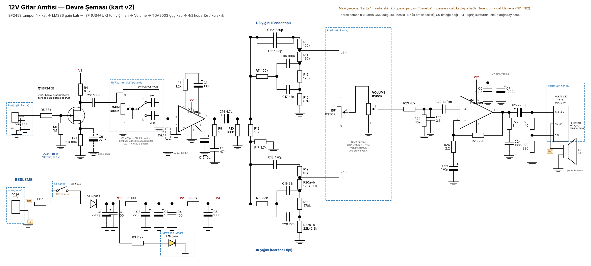
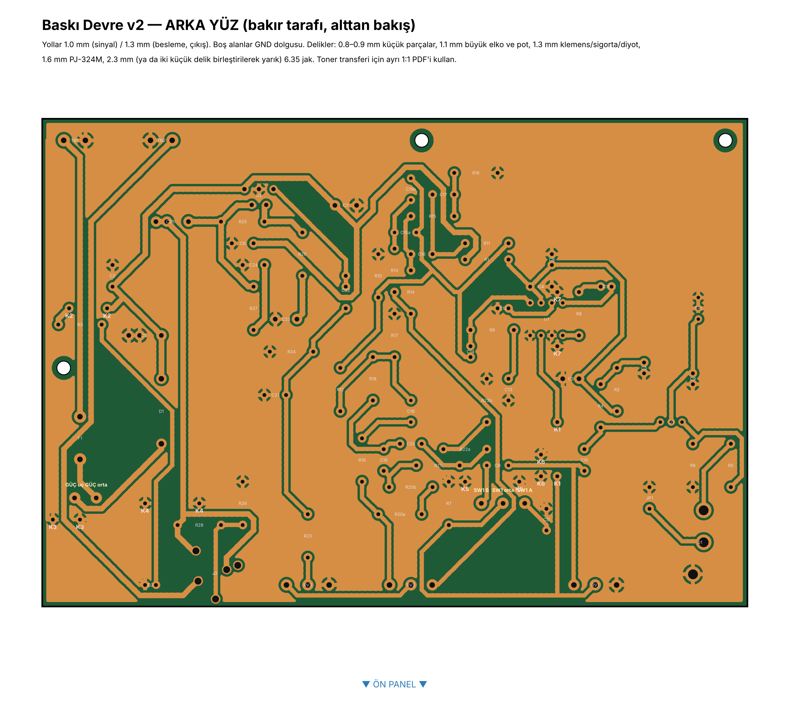
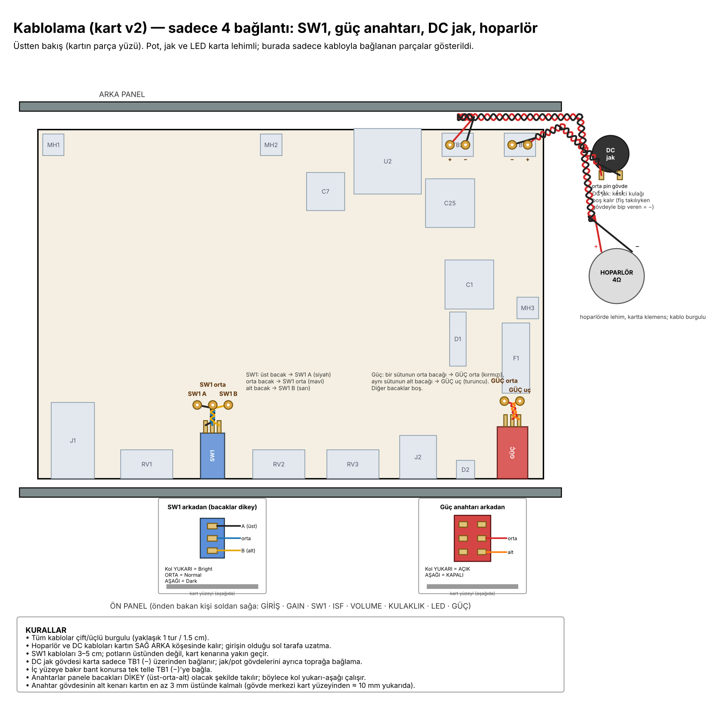

# 12 V gitar amfisi — BF245B + LM386 + TDA2003, ISF ton kontrolü

12 V ile çalışan, 4 Ω 6,5" full range hoparlör süren küçük bir pratik amfisi. Volume, Gain, ISF (US ↔ UK karakter) kontrolleri, Dark/Normal/Bright anahtarı ve kesicili 3,5 mm kulaklık çıkışı var. Tek yüzlü, ev yapımı (toner transfer) baskı devre üzerine kurulur; pot, jak, LED ve anahtarlar kartın ön kenarında dizilidir.

**Durum:** Kart v2 çizildi ve doğrulandı: kopuk ya da kısa devre yok, en dar aralık 0,5 mm, 7 tel köprü (K1–K7). Parçalar alındı. Kart henüz basılmadı, devre henüz denenmedi. **Aşındırmadan önce:** devir raporundaki "Sorulacaklar" listesindeki ölçüler alınmalı ve 1:1 baskı üzerinde parçalar denenmeli.

**Devir raporu (güncel durum, sorulacak ölçüler, sonraki adımlar):** https://claude.ai/artifact/CqNFPdVpvteivkdLXzBCgm

## Klasörler

| Klasör / dosya | İçerik |
|---|---|
| `images/1_devre_semasi.png` | Devre şeması |
| `images/2_pcb_on_yuz.png` | Parça yüzü |
| `images/3_pcb_arka_yuz.png` | Bakır yüzü (alttan bakış) |
| `images/4_kablolama.png` | Panel kablolaması, anahtarların arka görünüşü, bükümlü teller |
| `docs/6_toner_transfer_1e1.pdf` | Toner transfer için 1:1 baskı |
| `tools/` | Tasarım araçları (aşağıda) |
| `parca-gorselleri/` | Parçaların ürün görselleri ve çizimleri |
| `eski/v1/` | Eski kart (v1), eski alışveriş listesi ve proje dosyası — kullanılmıyor |

## Kontroller

| Kontrol | Parça | Ne yapar |
|---|---|---|
| Gain | B100K + R7 15k | LM386 katına giren sinyal; düşükte temiz, yüksekte crunch |
| SW1 | Mavi ON-OFF-ON | Yukarı Bright (470p) / orta Normal / aşağı Dark (3,3n) |
| ISF | B250K | Bir uç US (Fender tipi), öbür uç UK (Marshall tipi) |
| Volume | B500K | Güç katına giden seviye |
| Kulaklık | PJ-324M (kesicili) | Fiş takılınca hoparlör susar; L-pad (10 Ω / 330 Ω) |
| Güç | Kırmızı ON-ON, 6 bacak | Yukarı = açık |

- **Sinyal yolu:** gitar → Q1 BF245B → Gain + Dark/Bright → LM386 (≈38×) → ISF (iki sabit ton yığını arasında geçiş) → Volume → 47k/10k bölücü + ≈6 kHz alçak geçiren → TDA2003 (≈40 dB) → hoparlör / kulaklık
- **Besleme:** 12 V / 2 A adaptör → panel DC jak → TB1 → 1 A sigorta → güç anahtarı → 1N5822 → V12; RC filtrelerle LM386 (100 Ω) ve JFET (1k) beslemeleri ayrılır

## Baskı devre

165,1 × 114,3 mm, tek yüz bakır, 1,27 mm ızgara, boş alanlar GND dolgusu. Bakır desenden çıkarılan bağlantılar netlist ile karşılaştırıldı: kopuk ya da kısa devre yok.

Bakır yüzü (alttan bakış):

**Ön kenar yerleşimi (sol kenardan, mm):** J1 giriş 12 · RV1 Gain 36 · SW1 57 · RV2 ISF 79 · RV3 Volume 103 · J2 kulaklık 125 · D2 LED 140 · SW2 güç 155

**Tel köprüler (parça tarafı):** K1 GAINW · K2 V12 · K3–K7 GND. **K7 LM386 soketinin altından geçer, soketten önce lehimlenmeli.**

## Kablolama

- **SW1:** bacaklar dikey olacak şekilde takılır. Üst bacak = A (Dark), orta = ortak, alt = B (Bright). Kol yukarı = Bright.
- **Güç anahtarı:** tek sütunun orta ve alt bacakları kullanılır; orta = sigortadan sonra, alt = 1N5822'ye. Kol yukarı = açık.
- **DC jak** → TB1, **hoparlör** → TB2 (kulaklık jakının tip-NC kontağından gelir).

## Parça listesi (takılacak haliyle)

★ = tasarımdan farklı; çalışmayı bozmadığı için böyle bırakıldı (notlar aşağıda).

**Dirençler**

| Değer | Adet | Referanslar |
|---|---|---|
| 1 Ω | 1 | R27 |
| 2,2 Ω | 1 | R26 |
| 10 Ω | 2 | R9, R28 |
| 100 Ω | 1 | R1 |
| 220 Ω | 1 | R25 |
| 330 Ω | 1 | R29 |
| 1k | 1 | R2 |
| 1,2k | 1 | R8 |
| 2,2k | 2 | R3, R22b |
| 4,7k | 1 | R17 |
| 6,8k | 2 | R4, R16 |
| 10k | 4 | R12, R24, R20b, R5b ★ |
| 15k | 1 | R7 |
| 22k | 2 | R22a, R5a ★ |
| 33k | 1 | R18 |
| 47k | 1 | R23 |
| 91k | 1 | R19 |
| 100k | 3 | R10, R11, R13 |
| 120k | 2 | R15, R20a |
| 150k | 1 | R14 |
| 470k | 1 | R21 |
| 1M | 1 | R6 |

**Kondansatörler** (elektrolitiklerin hepsi yeni alındı, 25 V)

| Değer | Tür | Adet | Referanslar |
|---|---|---|---|
| 330p (331) | seramik | 1 | C15a ★ |
| 33p | seramik | 0 | C15b ★ boş |
| 470p | seramik | 2 | CB, C18 |
| 3,3n | film | 2 | CD, C21 |
| 22n | film | 2 | C19, C20 |
| 47n | film | 2 | C13, C17 |
| 100n | film | 6 | C2, C4, C6, C10, C16, C24 |
| 1µ | elektrolitik | 1 | C22 ★ |
| 4,7µ | elektrolitik | 1 | C14 |
| 10µ | elektrolitik | 2 | C11, C12 |
| 22µ | elektrolitik | 1 | C9 (isteğe bağlı) |
| 100µ | elektrolitik | 2 | C5, C8 |
| 220µ | elektrolitik | 1 | C3 |
| 470µ | elektrolitik | 1 | C23 |
| 1000µ | elektrolitik | 1 | C7 |
| 2200µ | elektrolitik | 2 | C1, C25 |

**Diğer**

| Parça | Adet | Referans |
|---|---|---|
| BF245B | 1 | Q1 |
| LM386 + DIP-8 soket | 1 | U1 |
| TDA2003 + klips soğutucu | 1 | U2 (soğutucu kartın arka kenarından taşar) |
| 1N5822 | 1 | D1 |
| Sarı LED (+ R3 2,2k) | 1 | D2 |
| 10k trimer | 1 | TR1 (drain ≈7 V'a ayarlanır) |
| B100K / B250K / B500K pot, 16 mm (WH148 tipi) | 1/1/1 | RV1 / RV2 / RV3 |
| 6,35 mm mono jak | 1 | J1 |
| PJ-324M | 1 | J2 |
| Vidalı klemens, 2'li | 2 | TB1, TB2 |
| Sigorta yuvası + 1 A sigorta | 1 | F1 ★ |
| Mavi ON-OFF-ON anahtar | 1 | SW1 |
| Kırmızı ON-ON 6 bacaklı anahtar | 1 | Güç |
| Panel DC jak, 3 uçlu | 1 | — |
| Bakır plaket 20 × 20 cm | 1 | — |
| M3 vida / mesafe | 3 | MH1–MH3 |
| 4 Ω 6,5" full range kâğıt hoparlör | 1 | Kablolar hoparlörün üzerinde lehimlenir, karta TB2 ile bağlanır |
| 12 V / 2 A adaptör | 1 | — |
| Kutu ve pot düğmeleri | — | 3D baskı |

**Düzenleme notları**

- **R5 33k → 22k + 10k seri ★**: ters U şeklinde R5 deliklerine. Tek 33k R18'e gider.
- **R20 = 120k + 10k, R22 = 22k + 2,2k**: kart bu çiftlere göre çizildi.
- **C15a ★ = 330p (331), C15b ★ boş.** Tasarım 220p + 33p idi. 330p, tasarımın kabul aralığında (220–330p); US yığınında tiz biraz artar. 220p bulunursa geri dönülür.
- **C22 ★ = 1 µF elektrolitik**: + ucu TDA2003 tarafına (TIN). Kartta 5 mm ve 7,5 mm iki delik var.
- **Potlar B ★**: A pot alınmadı; Gain için R7 15k (slider–GND) takılır.
- **Sigorta ★ 1 A normal (hızlı)**: tasarımda yavaş atan öngörülmüştü. Açılışta atarsa 1–2 A yavaş atan sigortaya geç.
- **Elektrolitikler**: hepsi yeni, 25 V (en az 16 V gerekli; görünüm aynı olsun diye hepsi yenilendi).

## Araçlar

Python 3 + numpy, scipy, Pillow, matplotlib. Komutlar `tools/` içinde çalıştırılır; çıktılar `out/` klasörüne yazılır.

- `params.py`: parça ölçüleri ve ön kenar konumları. **Ölçü değişince yalnızca burası düzeltilir.**
- `design2.py`: netlist ve ayak izleri.
- `place2.py`, `rsa2.py`: yerleşim (benzetimli tavlama).
- `route2.py`: yol çizici (Lee/Dijkstra, tel köprülü).
- `final2.py c121.json <tohum sayısı>`: son yönlendirme, GND dolgusu, doğrulama → `final_geom.pkl`.
- `draw_pcb2.py final_geom.pkl [çıktı klasörü]`: kart görselleri ve toner PDF'i.
- `schem2.py`, `wiring2.py`: şema ve kablolama çizimleri.
- `c121.json`: son yerleşim. `final_geom.pkl` (7,6 MB) sıkıştırılmış olarak `final_geom_kart-v2.zip` içinde; açıp `draw_pcb2.py final_geom.pkl` ile kullanılır ya da `final2.py c121.json` ile yeniden üretilir.
