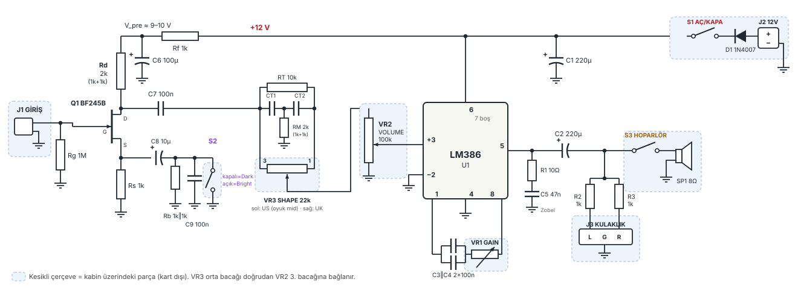
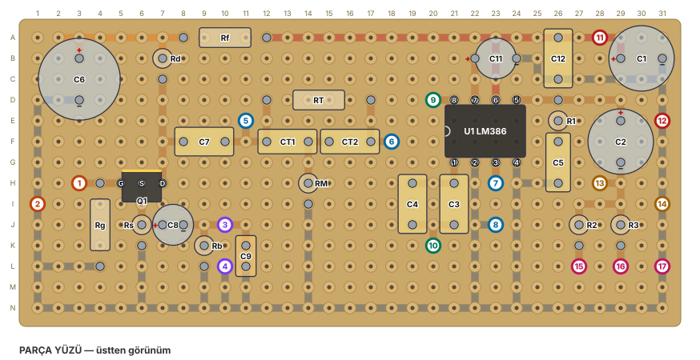
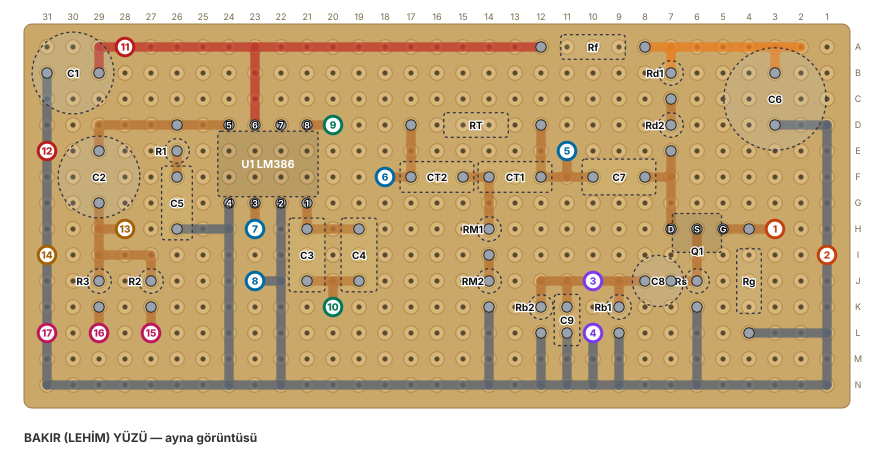
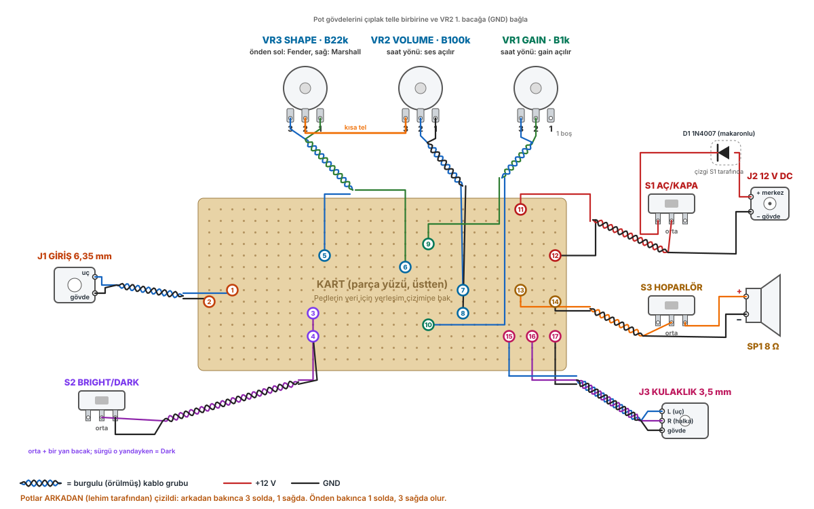

# LM386 Dumble tarzı mini gitar amfisi

BF245B JFET preamp, ISF tarzı Shape filtresi ve LM386 güç katından oluşan, 12 V ile çalışan küçük bir pratik amfisi. Adalı pertinaks üzerine kurulur; pot, anahtar ve jaklar küçük bir kabinde.

**Durum:** Revizyon 4 — tasarım tamam, parçalar elde (yeni hoparlör alınacak). Sıradaki adım breadboard denemesi ve kartın lehimlenmesi.



## Özellikler

| Kontrol | Parça | Yön | Ne yapar |
|---|---|---|---|
| Volume | VR2 B100k | Saat yönü = açılır | LM386'ya giren sinyal |
| Gain | VR1 B1k | Saat yönü = açılır | LM386 kazancı, 41–200 kat |
| Shape | VR3 B22k | Sol = Fender, sağ = Marshall | Sol: oyuk ortalar; sağ: düz, ortalar önde |
| S1 | Sürgülü anahtar | — | Aç/kapa (sarı güç LED'i) |
| S2 | Sürgülü anahtar | Kapalı = Dark | Dark: dolgun; Bright: ortalar ≈ 6 dB kısık, daha parlak |
| S3 | Sürgülü anahtar | — | Hoparlörü keser, kulaklık çalışır |

- Besleme: 12 V 2 A adaptör (ters polarite koruması 1N4007)
- Çıkış: 8 Ω hoparlöre yaklaşık 0,7–1 W temiz, en fazla ≈ 1,3 W. Önerilen hoparlör: 8 Ω, 3–5 W, 3–4 inç full range
- Kulaklık çıkışı: 3,5 mm stereo, kanal başına 1 kΩ seri

**Sinyal yolu:** gitar → Q1 BF245B (Bright/Dark) → Shape (köprülü-T çentik + VR3 geçiş) → Volume → LM386 (Gain) → hoparlör / kulaklık

## Revizyon geçmişi

| Rev | Değişiklik |
|---|---|
| 4 | Rd 2,2k, RM 2,2k, Rb 560 Ω (tek direnç); LM386 pin 7'ye C11 10 µF, pin 6'ya C12 100 nF; sarı güç LED'i |
| 3 | Bright/Dark kısmi bypass (≈6 dB fark), ISF tarzı Shape, gain potu B1k, 18×38 kart, kart dışı bağlantı şeması |
| 2 | Anahtar görevleri düzeltildi, VR4 trim kaldırıldı, D1 kart dışına alındı |

## Pertinaks yerleşimi

31 × 14 delik (18 × 38'lik adalı kartın sol üst köşesi). Sütunlar 1–31, satırlar A–N. Numaralı pedler kabine giden kablolar.



Alt yüzde lehimlerken ayna görüntüsünü kullan:



## Kart dışı bağlantılar

Potlar arkadan (lehim tarafından) çizildi: arkadan bakınca 3. bacak solda, 1. bacak sağda. 8 burgulu kablo grubu var.



## Dosyalar

| Yol | İçerik |
|---|---|
| [docs/proje-dosyasi.md](docs/proje-dosyasi.md) | Her şey dahil proje dosyası: kararlar, parça listesi (renk kodlarıyla), netlist, hesaplar, delik delik yerleşim, kablo tablosu, montaj ve ilk çalıştırma |
| [docs/sema-sayfasi.html](docs/sema-sayfasi.html) | Şema, yerleşim ve kablo tablolarını içeren tek sayfa (tarayıcıda aç) |
| `images/` | Şema ve çizimler (SVG) |
| `tools/layout.py` | Kart yerleşiminin tek kaynağı; çalıştırınca çakışma ve bağlantı kontrolü yapar |
| `tools/render.py`, `tools/wiring.py` | Şema, kart ve kablo çizimlerini üretir |
| `tools/build.py` | `index.html` şema sayfasını üretir |
| `tools/sim.py` | Bright/Dark ve Shape frekans tepkisi hesapları |

### Çizimleri yeniden üretmek

```bash
cd tools
python3 layout.py   # kontrol: "no errors"
python3 render.py   # schematic.svg, board_top.svg, board_bottom.svg
python3 wiring.py   # wiring.svg
python3 build.py    # index.html
```

Python 3 ve `numpy` (yalnızca `sim.py` için) yeterli.

## İlk çalıştırma

1. Adaptörün polaritesini (merkez +) ve BF245B'nin bacak sırasını ölç.
2. U1 takılı değilken güç ver: pin 6 ≈ 11,3 V, C6 + ≈ 9–10 V, Q1 drain 4,5–8,5 V, source 1–2,3 V.
3. Gücü kes, U1'i tak; ilk testi volume kısıkken yap.

Ayrıntılar için [proje dosyası](docs/proje-dosyasi.md).

## Notlar

- Değerler hesap ve basit simülasyonla belirlendi; devre bu haliyle henüz denenmedi. Lehimlemeden önce breadboard'da denemek önerilir.
- Gain potu için B10k da aynı pedlere takılabilir (daha düşük minimum kazanç, ama etkisi dönüşün son kısmında toplanır).
