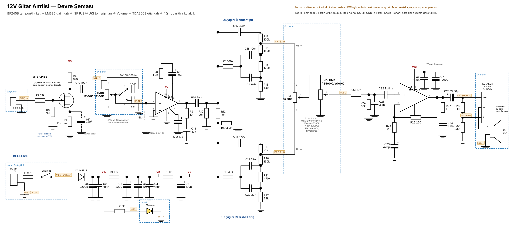
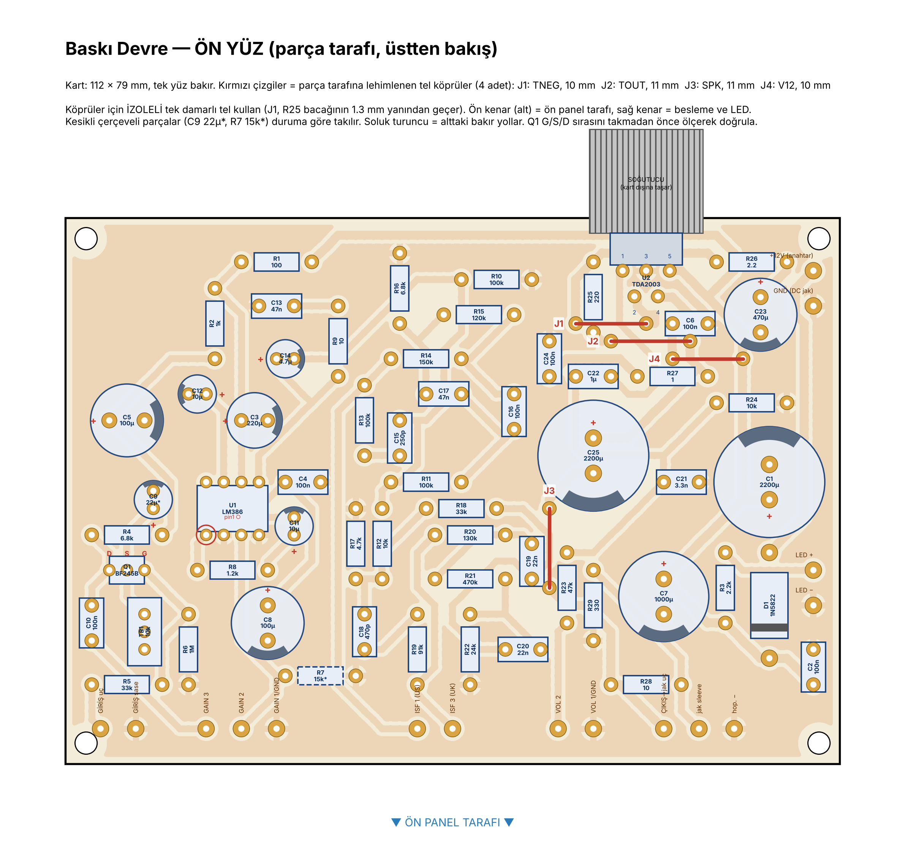
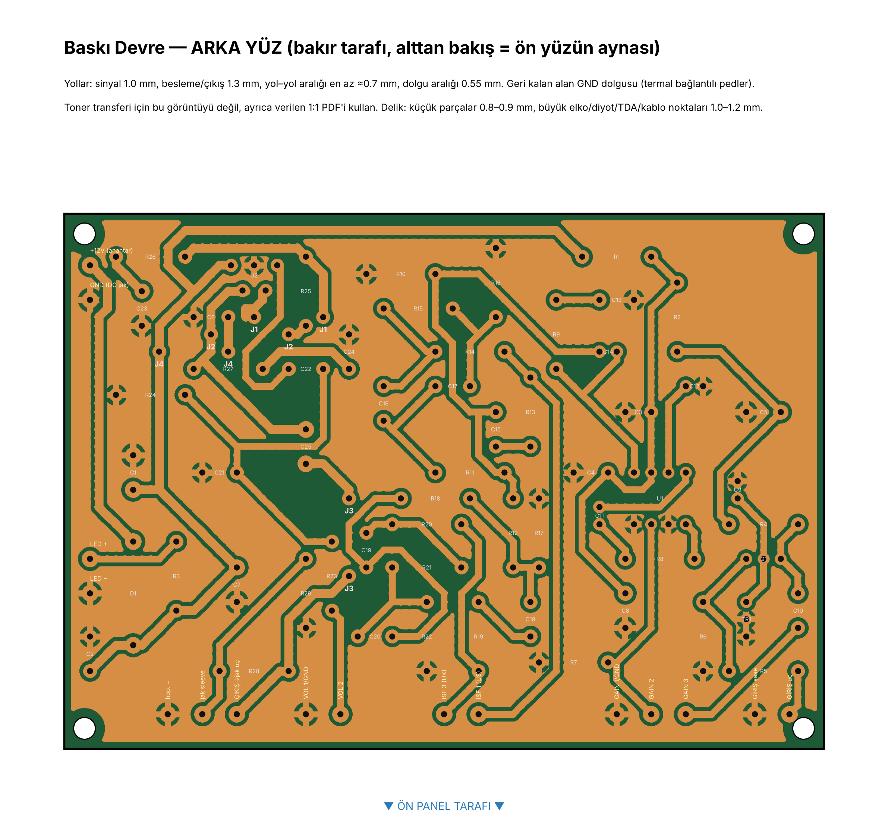
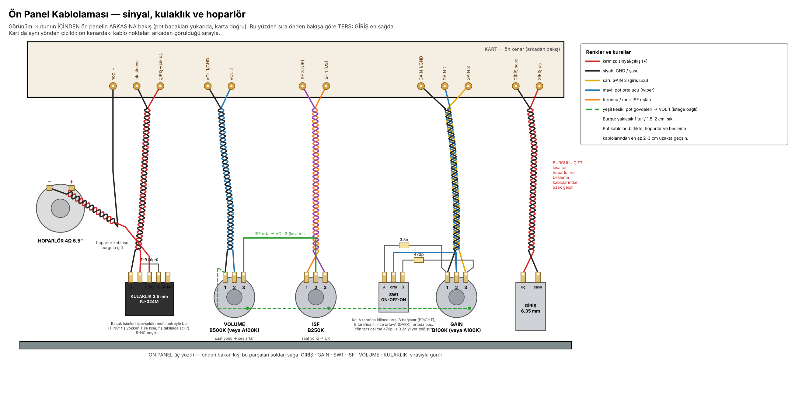
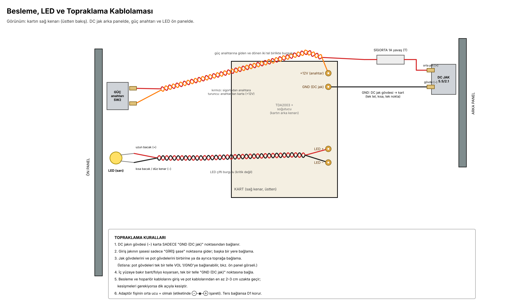

# 12 V gitar amfisi — BF245B + LM386 + TDA2003, ISF ton kontrolü

> **Eski sürüm (kart v1).** Bu klasör yalnızca arşiv içindir; güncel kart, parça listesi ve araçlar ana klasörde ([../../README.md](../../README.md)).

12 V ile çalışan, 4 Ω 6,5" full range hoparlör süren küçük bir pratik amfisi. Volume, Gain, ISF (US ↔ UK karakter) kontrolleri, Dark/Normal/Bright anahtarı ve kesicili 3,5 mm kulaklık çıkışı var. Devre tek yüzlü baskı devre üzerine kurulur; pot, anahtar ve jaklar ön panelde, karta kabloyla bağlanır.

**Durum:** Eski. Yerini ana klasördeki kart v2 aldı.



## Özellikler

| Kontrol | Parça | Ne yapar |
|---|---|---|
| Gain | B100K + 15k (veya A100K) | LM386 katına giren sinyal; düşükte temiz, yüksekte crunch |
| SW1 | SPDT ON-OFF-ON | Bright (470p) / Normal / Dark (3,3n) |
| ISF | B250K | Sol = US (Fender tipi, oyuk ortalar, parlak), sağ = UK (Marshall tipi, ortalar önde) |
| Volume | B500K (veya A100K) | Güç katına giden seviye |
| Kulaklık | 3,5 mm PJ-324M (kesicili) | Fiş takılınca hoparlör susar; L-pad (10 Ω / 330 Ω) ile kulakiçi ve kulaküstü için güvenli seviye |

- **Sinyal yolu:** gitar → Q1 BF245B → Gain + Dark/Bright → LM386 → ISF (iki sabit ton yığını arasında geçiş) → Volume → 47k/10k bölücü + ≈6 kHz alçak geçiren → TDA2003 → hoparlör / kulaklık
- **Besleme:** 12 V / 2 A adaptör, 1 A yavaş sigorta, 1N5822 ters polarite koruması
- **Çıkış:** 4 Ω hoparlöre yaklaşık 4–5 W

## Baskı devre

112 × 79 mm, tek yüz bakır, yollar 1,0 mm (sinyal) / 1,3 mm (besleme ve çıkış), en dar aralık 0,56 mm, boş alanlar GND dolgusu. Parça tarafına lehimlenen **4 izoleli tel köprü** (J1–J4) var. Bakır desenden çıkarılan bağlantılar netlist ile karşılaştırıldı: kopuk ya da kısa devre yok.



Bakır yüzü (alttan bakış):



Toner transferi için 1:1 çıktı: [docs/6_toner_transfer_1e1.pdf](docs/6_toner_transfer_1e1.pdf) — yazdırırken ölçeklendirme kapalı (%100), cetveli kumpasla kontrol et.

## Kablolama

Ön panel (kutunun içinden bakış — sıra önden bakışa göre ters):



Besleme, LED ve topraklama:



## Dosyalar

| Yol | İçerik |
|---|---|
| [docs/proje-dosyasi.md](docs/proje-dosyasi.md) | Kararlar, parça listesi (renk kodlarıyla), eşdeğerler, montaj ve ilk çalıştırma |
| [docs/12V_Gitar_Amfisi_Alisveris_Listesi.pdf](docs/12V_Gitar_Amfisi_Alisveris_Listesi.pdf) | Yazdırılabilir alışveriş listesi |
| [docs/6_toner_transfer_1e1.pdf](docs/6_toner_transfer_1e1.pdf) | Bakır katmanı, 1:1 |
| `images/` | Şema, kart ve kablolama görselleri |
| `tools/design.py` | Netlist ve parça ayak izleri (tek kaynak) |
| `tools/placement.json` | Son parça yerleşimi |
| `tools/render_final.py` | Yol çizimi, GND dolgusu ve bağlantı doğrulaması |
| `tools/draw_pcb.py` | Kart görselleri ve toner PDF'i |
| `tools/schem.py`, `tools/wiring.py` | Şema ve kablolama görselleri |
| `tools/place.py`, `tools/rsa.py` | Yerleşim optimizasyonu (yeniden yerleşim gerekirse) |

### Çizimleri yeniden üretmek

```bash
cd tools
python3 render_final.py placement.json 1   # "VERIFY errors: []" görmelisin
python3 draw_pcb.py
python3 schem.py
python3 wiring.py
```

Gerekenler: Python 3, numpy, scipy, matplotlib, Pillow.

## İlk çalıştırma (özet)

1. Delmeden önce parçaların bacak aralıklarını 1:1 çıktının üstünde kontrol et (elektrolitikler ve film kondansatörler).
2. BF245B'nin gate bacağını multimetrenin diyot kademesiyle bul (bacak sırası üreticiye göre değişir).
3. Önce TDA2003 katı: giriş boşta, uğultu ve ısınma olmamalı. Sonra LM386: pin 5 ≈ 6 V. En son JFET: TR1 ile drain ≈ 7 V.

Ayrıntılar: [proje dosyası](docs/proje-dosyasi.md).
