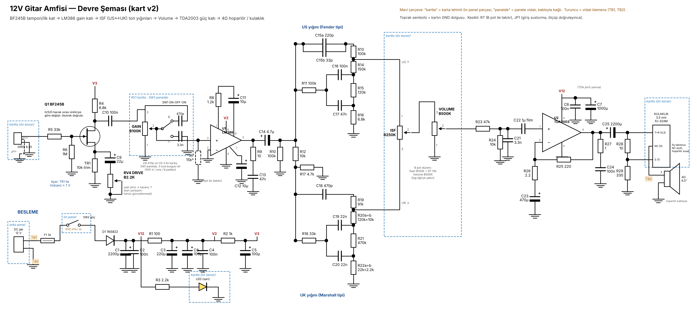
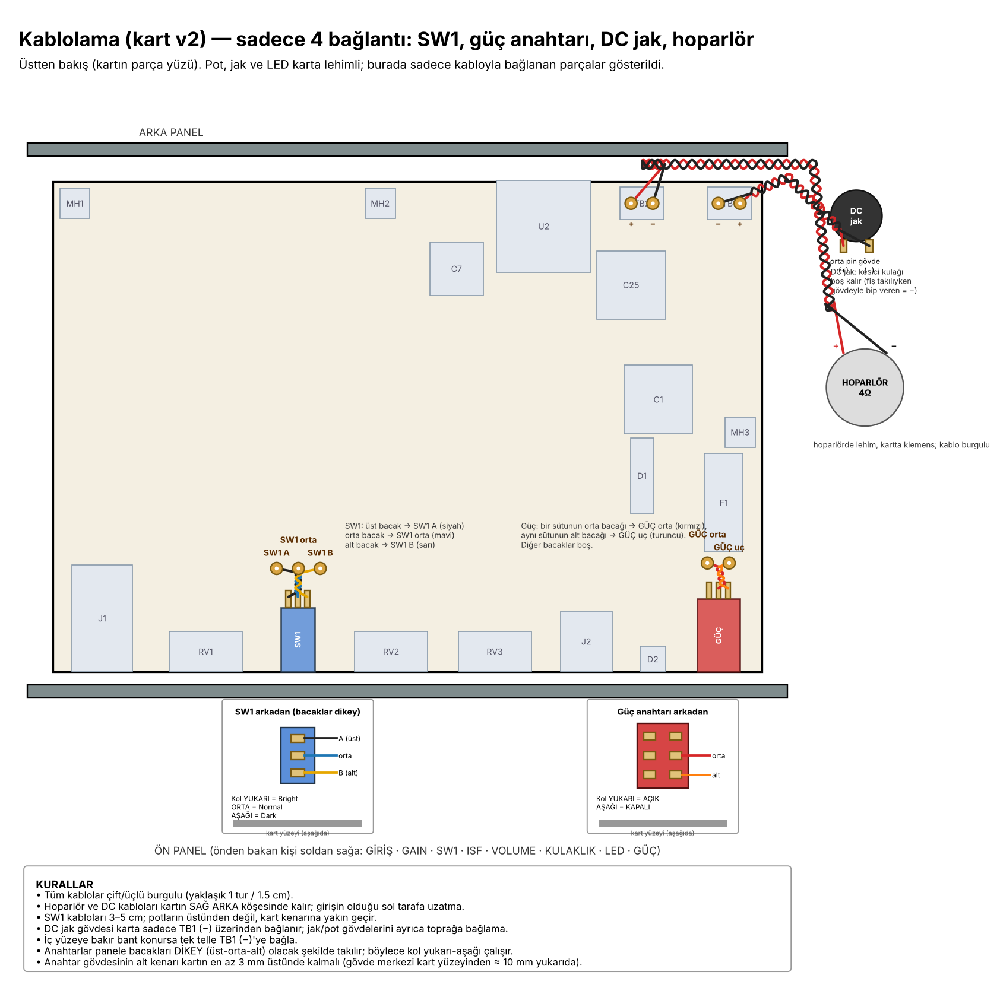
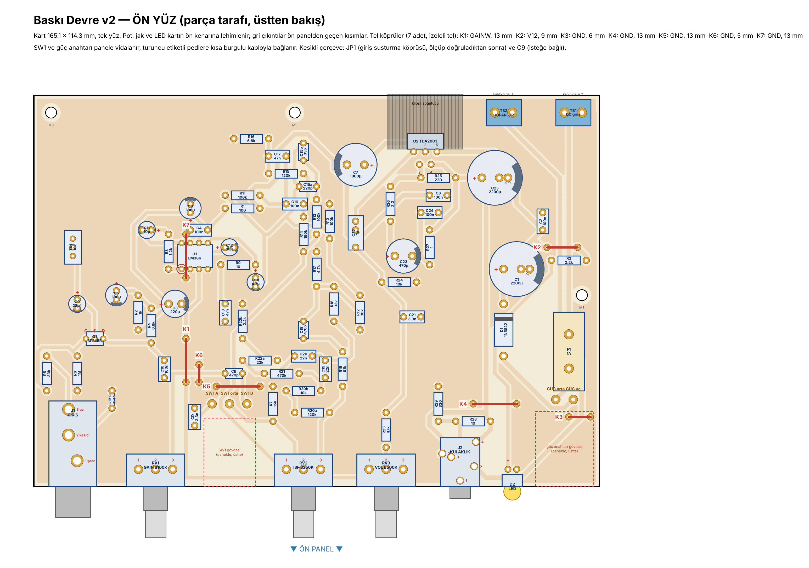
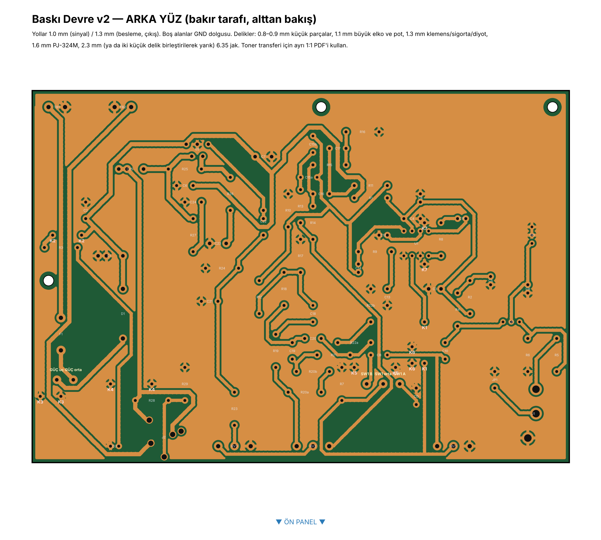

# Kart v2 ve kart v3 taslağı (arşiv)

> **Eski sürüm.** Yerini önce kart v4 ([`../v4_kicad_185x96/`](../v4_kicad_185x96/README.md)), sonra güncel kart v5 ([`../../guncel/kicad/`](../../guncel/kicad/)) aldı. Bu klasör yalnızca arşiv içindir.

Kendi Python araçlarıyla (yerleşim + yönlendirme) üretilmiş kartlar. Devre aynı (Rev 5 + RV4 DRIVE); şema görselindeki parça adları eski (C15a/b, R20a/b, R22a/b, CB, CD — güncel adlar: C15/C26, R20/R30, R22/R31, CB1, CD1).

| Klasör | İçerik |
|---|---|
| `gorseller_v2/` | Kart v2: devre şeması, parça/bakır yüzü, kablolama, toner 1:1 PDF |
| `gorseller_v3/` | Kart v3 taslağı: parça/bakır yüzü, toner 1:1 PDF, köprü listesi |
| `araclar/` | v2/v3 araçları; `design2.py` + `params.py` netlist ve ölçü kaynağıdır (güncel KiCad şeması da bu netlistten üretildi, `guncel/kicad/gen_sch.py` buradan okur). `kart_ara.py` + `baslat.bat`: v3 yerleşim arama programı (`BENIOKU.txt`) |

## Baskı devre (v2, arşiv)

165,1 × 114,3 mm, tek yüz bakır, 1,27 mm ızgara, boş alanlar GND dolgusu. Bakır desenden çıkarılan bağlantılar netlist ile karşılaştırıldı: kopuk ya da kısa devre yok.

Bakır yüzü (alttan bakış):

**Ön kenar yerleşimi (sol kenardan, mm):** J1 giriş 12 · RV1 Gain 36 · SW1 57 · RV2 ISF 79 · RV3 Volume 103 · J2 kulaklık 125 · D2 LED 140 · SW2 güç 155

**Tel köprüler (parça tarafı):** K1 GAINW · K2 V12 · K3–K7 GND. **K7 LM386 soketinin altından geçer, soketten önce lehimlenmeli.**

## Kart v3 taslağı

v3'te netleşen tasarım/yapım kararları (Proteus'ta da geçerli):

| Konu | v3 kararı |
|---|---|
| Elektrolitikler | En yakın standart kılıf; bacaklar gövde dibindeki aralıkla delinir, hepsi karta tam oturur (bükümler düzeltilir). 2200 µF Ø12,5 / 5,0 mm · 1000 µF Ø10 / 5,0 · 470 µF Ø8 / 3,5 · 220 µF Ø6,3 / 2,5 · 100/22/10/4,7/1 µF Ø5 / 2,0 mm |
| C22 1 µF | Elektrolitik, tek delik çifti (2,0 mm); + ucu TDA2003 girişine (TIN) |
| Q1 BF245B | Parça Fairchild (F logolu): **1 = G, 2 = S, 3 = D** (NXP düzeninin tersi) |
| RV4 DRIVE | B2.2K pot, ön kenarda J1 ile Gain arasında; C9: + JFET source, − RV4 3. bacak, 1–2. bacak GND (saat yönü = daha çok kazanç) |
| J1 6,35 mm jak | 3 numara (en arkadaki) uç olarak doğrulandı |
| Kart eni | 185 mm (RV4 için +20 mm); ön kenar: J1 12 · RV4 34 · RV1 56 · SW1 77 · RV2 99 · RV3 123 · J2 145 · D2 160 · SW2 175 mm |
| Parazit | Arka/sol/sağ kenarda kesintisiz GND şeridi; TDA2003 soğutucusunun altı yalnız GND; giriş katı solda, güç katı sağda |
| Tel köprüler | Ayrı parça (K1–K8), yalnız yatay/dikey, ≤ 12,7 mm, entegre ya da başka parça üstünden geçmez; liste `gorseller_v3/kopru_listesi.csv` |
| C23, C19/C20 | Değişmedi (470 µF; 22n) |

Araçlar artık `araclar/ayarlar.json` dosyasını okur (kart eni, köprü kuralları, GND şeridi). v3 yerleşimi `araclar/v3_yerlesim.json`, son geometri `araclar/final_geom_kart-v3.zip`. `araclar/kart_ara.py` (+ `baslat.bat`) çok çekirdekli yerleşim arama arayüzüdür; bu kart için yeterli sonuç vermedi, kayıt için duruyor. v2'yi yeniden üretmek için `ayarlar.json` içinde `kart_eni` 165, `ring` 0 yapılmalı ve f0ccc7e commit'indeki araçlar kullanılmalı (v2 geometrisi `final_geom_kart-v2.zip`).

## Araçlar

Python 3 + numpy, scipy, Pillow, matplotlib. Komutlar `araclar/` içinde çalıştırılır; çıktılar `out/` klasörüne yazılır.

- `params.py`: parça ölçüleri ve ön kenar konumları. **Ölçü değişince yalnızca burası düzeltilir.**
- `design2.py`: netlist ve ayak izleri.
- `place2.py`, `rsa2.py`: yerleşim (benzetimli tavlama).
- `route2.py`: yol çizici (Lee/Dijkstra, tel köprülü).
- `final2.py c121.json <tohum sayısı>`: son yönlendirme, GND dolgusu, doğrulama → `final_geom.pkl`.
- `draw_pcb2.py final_geom.pkl [çıktı klasörü]`: kart görselleri ve toner PDF'i.
- `schem2.py`, `wiring2.py`: şema ve kablolama çizimleri.
- `c121.json`: son yerleşim. `final_geom.pkl` (7,6 MB) sıkıştırılmış olarak `final_geom_kart-v2.zip` içinde; açıp `draw_pcb2.py final_geom.pkl` ile kullanılır ya da `final2.py c121.json` ile yeniden üretilir.
