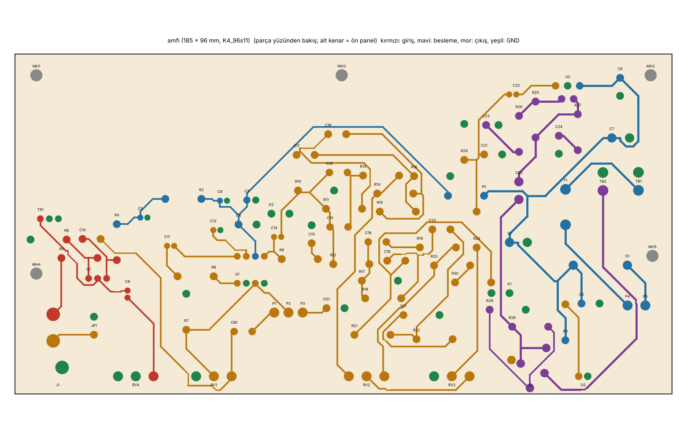
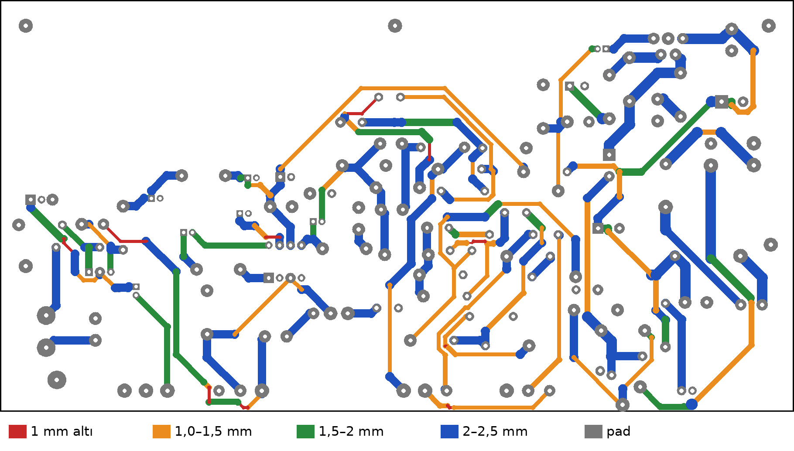

# Kart v4 — KiCad + Freerouting, 185 × 96 mm (arşiv)

> **Eski sürüm.** Yerini kart v5 aldı: [`../../guncel/kicad/`](../../guncel/kicad/). Bu klasör yalnızca arşiv içindir.

KiCad 10'da `../v2_v3/araclar/design2.py` netlistinden üretilen, Freerouting ile yönlendirilen kart. GND dolgusu, 2 tel köprü (K1, K2). 18 Kasım'da yerleşim aynı kalarak yollar 1–2,5 mm'ye kalınlaştırıldı (eski PR #12, `kalin-yollar` dalı). Toner transferde sorun çıkınca kart v5'e geçildi.

| Klasör / dosya | İçerik |
|---|---|
| `amfi/` | KiCad projesi (`amfi.kicad_pro`; şema, kalınlaştırılmış kart, kütüphane, kurallar) |
| `cikti/` | Toner A4 1:1 PDF, parça yerleşimi PDF, lazer dosyaları (`lazer/`), teslim raporu (`TESLIM_RAPORU.md`) |
| `gorseller/` | Kart görseli, toner önizlemesi, yol kalınlığı haritası |
| `*.py`, `kopruler.json` | Üretim, yerleşim, toplu yönlendirme, analiz, köprü, kalınlaştırma ve PDF betikleri |

KiCad 10 projesi `amfi/` klasöründe (`amfi.kicad_pro`). Şema, sembol ve ayak izi kütüphanesi `gen_kicad.py` ile `../v2_v3/araclar/design2.py` netlistinden üretilir; elle çizilmedi.

| Konu | Değer |
|---|---|
| Boyut | 185 × 96 mm (ön kenar = panel; v3'e göre 18 mm daha kısa) |
| Bakır | Yalnız B.Cu (alt). Üst katta yol/via yasak (kural alanı + `amfi.kicad_dru`) |
| GND | Alt katın tamamında dolgu, padler dolguya doğrudan (termal kolsuz) bağlı. Sinyal yolları Freerouting'le çizildi, GND'yi dolgu bağlar |
| Tel köprüler | K1 (D2 tarafındaki GND adası) ve K2 (C3 tarafındaki GND adası), ikisi de 5,08 mm, düz; parça gövdesi üstünden geçmez, sinyal netlerinde köprü yok |
| Yol genişliği | **Kalınlaştırıldı (18 Kasım):** yerleşim aynı, her yol 0,5 mm aralığı bozmadan sığdığı kadar genişletildi — uzunluğun %43'ü 2–2,5 mm, %16'sı 1,5–2 mm, %38'i 1,0–1,5 mm (sıkışık bölgeler), %2'si 1 mm altı (eski dar pin girişleri). Padler sığan yerlerde 1 mm halkaya büyütüldü. Harita: `gorseller/yol_kalinlik_haritasi.png` |
| Aralık / kenar | Bakır–bakır ≥ 0,5 mm; arka/sol/sağ kenarda 1 mm yolsuz şerit, ön kenarda (potların altı) 0,5 mm |
| Vida delikleri | M3 × 5: arka kenarda 3, ön tarafta 2 (MH4 J1'in arkasında, MH5 güç anahtarının arkasında) |
| Ön panel sırası | Değişmedi: J1, RV4, RV1, SW1, RV2, RV3, J2, LED, güç anahtarı |

**Gürültü ölçütleri (seçilen kart):** giriş yolu J1 → R5 → Q1 gate 33 mm; giriş netlerine en yakın güç/çıkış yolu 110 mm; hoparlör akım döngüsü (TDA çıkışı → C25 → hoparlör → GND) 374 mm²; TDA girişi (TIN) yolu 55 mm; giriş katı solda, güç katı sağ arkada, besleme sağ kenarda.

**Çıktılar:**
- `cikti/toner_alt_bakir_1e1_A4.pdf` — toner transfer için B.Cu, A4, 1:1, vektör, delik merkez işaretli. Aynalamadan, %100 bas.
- `cikti/parca_yerlesimi_A4.pdf` — parça yüzü yerleşimi (serigrafi), A4.
- `cikti/lazer/` — lazerle boya yakma / kazıma için 1:1 dosyalar: aynalı 1000 dpi PNG ve SVG, üstten SVG, DXF; açıklama `OKUBENI.txt`.

**Kalınlaştırma betikleri:** `kalinlastir.py` (yolları/padleri aralığı koruyarak büyütür, GND dolgusunun bölünmemesini `dolgu.py` ile denetler), `son.py` (KiCad konsolunda dolgu + DRC + A4 PDF), `gorsel.py` (önizleme ve lazer dosyaları), `genislet.py` (yardımcı geometri).

**Parça adı değişiklikleri (KiCad harf sonekini kabul etmediği için):** C15a → C15, C15b → C26, R20a → R20, R20b → R30, R22a → R22, R22b → R31; KiCad'de CB → CB1, CD → CD1, anahtar kablo padleri P_SWB/P_SWC/P_SWD → P1/P2/P3, P_PW1/P_PW2 → P4/P5. Yeni: MH4, MH5 (vida), K1, K2 (tel köprü).

**Nasıl üretildi:** `yerlesim.py` (elle düşünülmüş yerleşim tohumları + çakışma çözücü) → `toplu.py` (KiCad konsolunda Freerouting'i toplu, penceresiz çalıştırır) → `analiz.py` (kopuk bağlantı, GND adaları, gürültü ölçütleri) → `kopru.py` / `kopru_ekle.py` (GND adaları için en kısa düz köprü). `cikti.py` KiCad konsolunda toner (B.Cu, 1:1) ve parça yerleşimi PDF'lerini `cikti/` klasörüne üretir. Seçilen yerleşim: `KART_H=96 python yerlesim.py "K4@96#11"`. 185 mm genişlikte 114 → 84 mm arası yaklaşık 150 kart denendi; 96 mm, tamamen yönlendirilmiş ve en az köprü (2) isteyen en küçük karttı.
